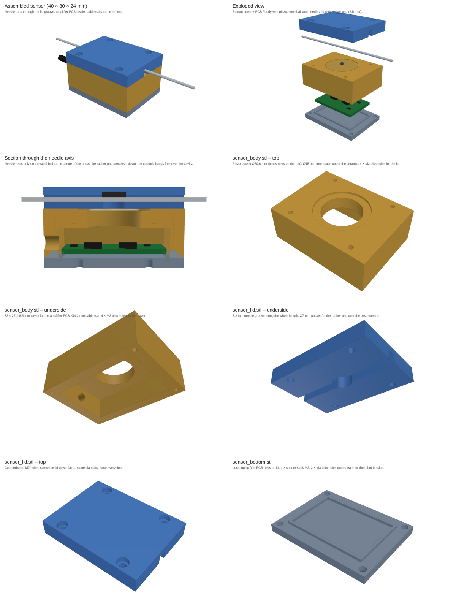

# Hardware: schematic + 3-D printed sensor housing

## Schematic: `schematic/`
`amp_filter_schematic.pdf / .svg / .png`, generated by `make_schematic.py` (schemdraw). Rev D = your Rev C, plus:

| Block | Parts |
|---|---|
| 1. Piezo input + gain | J1 piezo, R1 22k, R2 4.7M, D1 BAV99 to VREF, U1A gain 11 (JP1 closed) / 48 (open) with R3a 22k + R3b 82k, R4 2.2k, C5 47p |
| 2. Reference | R5/R6 10k, C4 10µ, U1B buffer gives VREF = 1.65 V |
| 3. Low-pass | U2A: R8/R9 9.1k, C8 1.2n, C9 1n (Q 0.55, 16.0 kHz). U2B: R10/R11 3.9k, C10 6.8n, C11 1n (Q 1.30, 15.7 kHz) |
| 4. Outputs | J3 OUT_DC (R7 100Ω, C6 10n) to ESP32 GPIO1. J4 OUT_AC (C7 2.2µ, R13 100Ω) to PCM1808 L |
| 5. Power | J2 3V3 → R12 10Ω → AVDD, C3 47µ, C2/C12 100n at pin 8 of each MCP6002 |

Values and response: see `../WIRELESS_DESIGN.md` and `../software/filter_response.py`.
To transfer it into your KiCad Rev C project: delete C1, change the values above, and add R3b + JP1 (solder jumper), C5, C7, R13 and J4.

## Sensor housing: `stl/`

| File | Size (mm) | What it is |
|---|---|---|
| `sensor_body.stl` | 40 × 30 × 14 | Piezo pocket on top (brass rests on its rim, so the ceramic is free to flex). 32 × 22 × 8.5 cavity underneath for the 30 × 20 mm amplifier PCB. 4.2 mm cable exit. |
| `sensor_lid.stl` | 40 × 30 × 6 | Clamp. 3.2 mm needle groove along X, plus a Ø7 mm pocket over the piezo centre for a **rubber pad** (2.5 mm thick, e.g. cut from an eraser). Screwing the lid flat always compresses the pad by about 0.9 mm, so the **clamping force is the same in every experiment.** |
| `sensor_bottom.stl` | 40 × 30 × 4 | Cover with locating lip, 4 × countersunk M2 (flat head). Two M3 pilot holes (20 mm apart) for mounting on the robot. |

Regenerate for other parts: `python stl/make_stl.py --piezo 27 --pcb 40x25 --needle 2.0`
(27 mm disc, DIP-version PCB, 2 mm Veress needle). It prints the key heights.

### Print
PETG (better) or PLA, 0.2 mm layers. Body at **100 % infill** (solid plastic carries vibration better and damps resonance more evenly).
Print the body upside-down (cavity facing up) and the lid upside-down too (flat top on the bed). Neither needs supports.

### Assembly (20 mm piezo, 18G needle)
1. Stick a ring of **0.5 mm double-sided foam tape** on the pocket rim, then press the piezo in, **brass side up**. The wires go down through the centre hole into the cavity.
2. Glue a **2 mm steel ball** (from a bearing or a bike shop) or a hard drop of epoxy to the **centre of the brass**. The needle touches only this point:
   one hard metal contact transmits the high-frequency puncture "clicks".
3. Solder the piezo to J1 on the amplifier PCB (wires under 3 cm). Stick the PCB to the bottom cover with foam tape. Bring the shielded 3-wire cable
   (3V3 / GND / OUT) out through the side hole. Close with 4 × M2 × 8 flat-head screws.
4. Lay the needle in the lid groove over the ball, put the rubber pad in the pocket, and close the lid with 4 × M2 × 8 screws **until it sits flat**.
5. Mount on the robot with 2 × M3 screws through your bracket into the bottom cover, with a rubber washer under each screw to isolate motor vibration.

Heights for the default build: brass top z = 13.9 mm, needle axis z = 16.5 mm, lid groove 3.8 mm deep, pad pocket 4.8 mm deep.
